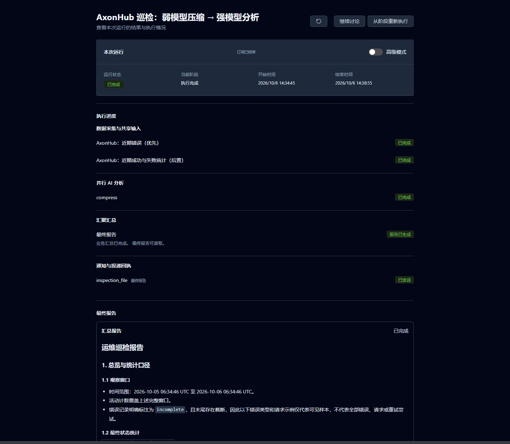
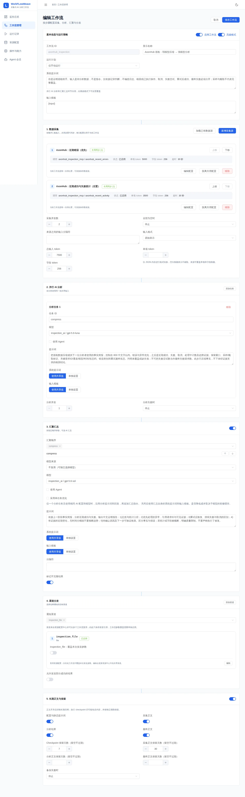
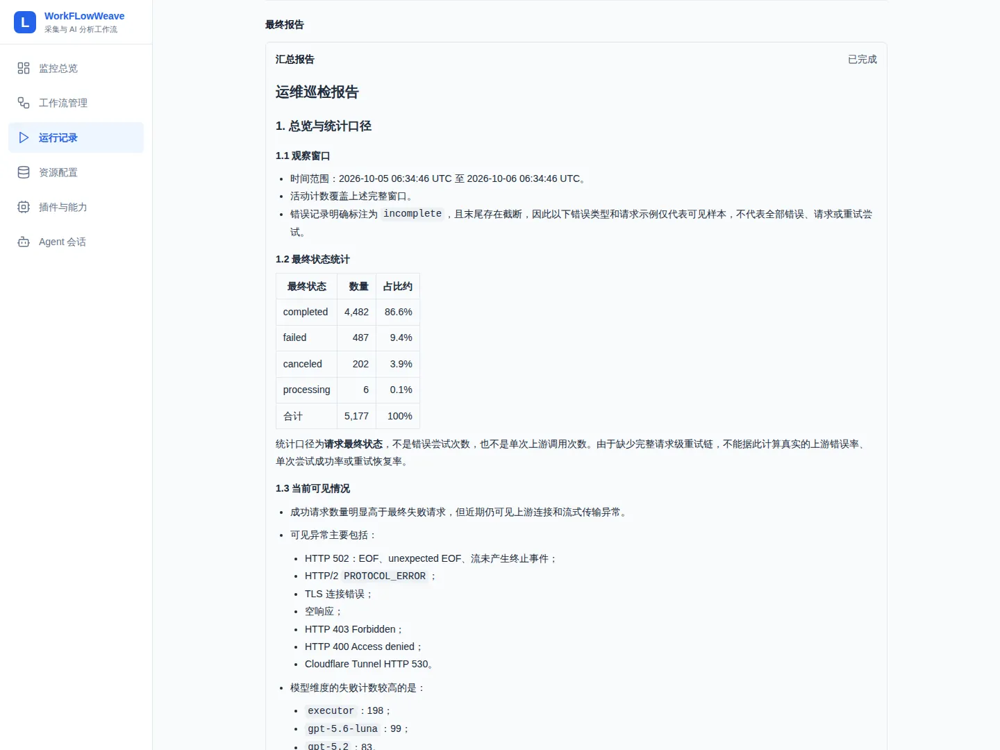
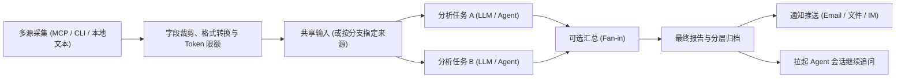

<div align="center">
  <h1>WorkFLowWeave</h1>
  <p><strong>把日常重复的数据采集、AI 分析与推送固化为可复用的工作流；需要深挖时，再拉起 Agent 接着聊。</strong></p>
  <p>
    <a href="https://www.python.org/"></a>
    <a href="https://vuejs.org/"></a>
    <a href="https://fastapi.tiangolo.com/"></a>
    <a href="LICENSE"></a>
  </p>
</div>

> OpenCode Go 首充优惠没了，很多大模型额度都改为了 $15，这不是近乎原价吗，Agent 就这样因为钱包关起门来吗？
>
> 但是或许，我们可以借助 WorkFlow 的力量，把需求固定下来，让钱包起死回生。

---

## 为什么做 WorkFLowWeave？

平时用 OpenClaw 这类重型 Agent 工具，很多人最常跑的其实就是**定时盯几个固定信息源、做一轮汇总或巡检**。这类任务的来源、触发时间和处理步骤早就定死了，如果每次执行都让 Agent 从头规划、挑工具、跑多轮循环，不仅耗时、结果容易漂，Token 账单也根本顶不住。反过来，如果只用传统的死板工作流，看到某条告警或简报觉得不对劲、想顺着查一下日志或代码时，又没法直接接着聊。

**WorkFLowWeave** 的思路很简单：**把确定的流程交给 Workflow，把不确定的追问留给 Agent。**

- **省掉重复规划的开销**：把数据源（MCP 工具、CLI 命令、本地文本引用）、字段裁剪规则和通知渠道固化下来，支持手动触发或按 Cron / 固定间隔定时运行。
- **好钢花在刀刃上**：不同分析分支可以分别指定便宜的轻量模型、强推理模型，或是带工具的 Agent 模式；共享系统提示词与输入前缀也有利于命中同一模型服务的 Prompt Cache。
- **工作流跑完可以直接接着聊**：每次运行的采集数据、各分支结论与最终报告都会分层归档。发现问题时，可以从当次运行记录一键拉起 Agent 会话，带着当时的上下文和 MCP 工具范围继续排查。
- **小机器也能常驻运行**：纯异步 Python 后端 + Vue 3 前端，不绑重型中间件。在 2 vCPU / 1.6 GiB 内存（无 swap）的云主机上，完整前后端峰值工作集不到 190 MiB。

## 界面预览


| 工作流编排配置（来源、Token 预算、多分支模型与通知） | 运行记录与巡检报告预览 |
| :---: | :---: |
|  |  |

## 快速开始

可以安装 Python wheel 单命令启动，也可以拉取 Docker 镜像或从源码分别启动后端和前端。

### Python 包安装

需要 Python 3.11+。安装发布 wheel 后无需 Node.js 或源码仓库：

```bash
pip install workflowweave
workflowweave serve
```

访问 `http://127.0.0.1:4333`，同一服务提供 Web 界面与 API。首次启动自动在平台用户数据目录创建 `config.json`，并将数据库、资源、插件设置及密钥保存在该目录；Linux 默认为 `~/.local/share/workflowweave`，遵循 `XDG_DATA_HOME`。已有配置不会被覆盖。

```bash
workflowweave serve --host 127.0.0.1 --port 4333 --data-dir /path/to/state
```

对应环境变量为 `WORKFLOWWEAVE_HOST`、`WORKFLOWWEAVE_PORT`、`WORKFLOWWEAVE_DATA_DIR`。优先级为命令参数、环境变量、已有配置、默认值；监听覆盖只对本次进程生效。原有 `workflowweave start --config config.json` 保持兼容。

微信渠道及其 JavaScript SDK 随 wheel 分发，启用渠道或扫码登录时才启动 bridge。常规 `pip install workflowweave` 会在 Node wheel 支持的 x86_64 平台一并安装 Node.js（Linux glibc 2.28+/musl 1.2+、macOS 13+、Windows）；ARM64 不随包安装 Node，启用微信时需在系统安装 Node.js 22+。优先使用随包 Node，其次系统 `node`；微信渠道的 `command` 可指定可执行文件。缺少 Node 时主服务只记录 warning，启用微信时明确报错。

从源码构建发布包需要 **Python 3.11+、Node.js 22+ 和 npm**。构建会根据前端与微信 bridge 的锁文件安装依赖，并将前端生产资源及 SDK 放入 wheel：

```bash
uv build --python 3.12
uvx twine check dist/*
```

源码 editable 安装跳过 Web 构建，继续使用下方 Vite 开发模式。PyPI 通过 GitHub Release 和 Trusted Publishing 自动发布；通过本地构建与安装验收并不代表已经发布。

### 方式一：Docker 部署（推荐）

**前后端合一（推荐）**

```bash
docker pull ghcr.io/striiiiiing/workflowweave-backend:full
docker run -d --name workflowweave --restart unless-stopped \
  -p 3332:80 \
  -v workflowweave_state:/var/lib/workflowweave \
  ghcr.io/striiiiiing/workflowweave-backend:full
```

**前后端分开部署**

```bash
docker pull ghcr.io/striiiiiing/workflowweave-backend:latest
docker pull ghcr.io/striiiiiing/workflowweave-frontend:latest
docker network create workflowweave
docker run -d --name workflowweave-backend --restart unless-stopped \
  --network workflowweave --network-alias backend \
  -v workflowweave_state:/var/lib/workflowweave \
  ghcr.io/striiiiiing/workflowweave-backend:latest
docker run -d --name workflowweave-frontend --restart unless-stopped \
  --network workflowweave -p 3332:80 \
  ghcr.io/striiiiiing/workflowweave-frontend:latest
```

启动后访问 [http://localhost:3332](http://localhost:3332)。

运行数据保存在 `workflowweave_state` 命名卷中。

目前面向个人单用户使用，尚无登录鉴权。请在本机或可信网络内访问；需要公网访问时，先在反向代理或 VPN 侧限制访问。

**旧版本升级注意**：已有 `config.json` 中的 `port` 请手动改为 `4333`；已有 `.env` 中的 `FRONTEND_PORT` 改为 `3332`，然后重新创建容器或重启服务。已有配置不会被自动覆盖。

### 方式二：从源码启动

**1. 准备后端环境（需 Python 3.11+ 与 [uv](https://docs.astral.sh/uv/getting-started/installation/)）**

```bash
git clone https://github.com/striiiiiing/WorkFLowWeave.git
cd WorkFLowWeave
uv sync --group dev
```

如需启用邮件、QQ、飞书或 Telegram 渠道 SDK，可按需加上 `--extra channels`（或单独加 `--extra email` / `qq` / `feishu` / `telegram`）。

**2. 生成配置并启动后端**

首次运行先生成一份默认 `config.json`（若已有配置文件可跳过第一行）：

```bash
uv run workflowweave config-example --output config.json
uv run workflowweave start --config config.json
```

后端默认监听 `http://127.0.0.1:4333`。保持该终端运行，另开一个终端启动前端。

**3. 启动前端（需 Node.js 22.22.2+ 或 24.15.0+）**

```bash
cd frontend
npm ci
npm run dev
```

前端默认使用 `3332` 端口，并将 API 请求转发到后端 `4333` 端口。需要自定义后端地址时，在启动前端前设置 `API_TARGET`。

**4. 检查服务状态**

```bash
curl -i http://127.0.0.1:4333/api/health
curl -i http://localhost:3332/api/health
```

两个接口都返回 HTTP `200` 与 JSON 健康报告即表示就绪；若返回 `503`，可按响应中的组件诊断信息排查。

---

## 5 分钟跑通第一个工作流

新装系统的资源库是空的，你可以直接在网页里点选配置，也可以用 JSON + CLI 导入。

### 在 Web 界面创建

1. **添加数据源**：进入「资源管理」，配置一个 MCP 服务与工具调用、一条后端可执行的 CLI 命令，或上传一份本地参考文本。
2. **添加模型服务**：添加 `OpenAI Compatible API` 服务，填入 `base_url`、API Key 和模型名称（工作流和 Agent 共用这套配置）。
3. **配置通知渠道（可选）**：启用内置的 Email、文件（`file`）、QQ、微信、飞书或 Telegram 插件并填入对应参数。
4. **组装工作流**：勾选数据源，添加一或多个分析任务并分配模型与提示词，按需开启汇总（Fan-in）、通知和定时计划。
5. **运行与追问**：点击运行后在「运行记录」实时查看各阶段输出。如果要针对某次结果继续深挖，直接点击从该次结果新建 Agent 会话。

### 用 JSON + CLI 创建

假设你已经配置好了数据源 `my_source`、AI 服务 `my_ai`（含模型 `my_model`），可以把工作流写成 `workflow.json`：

```json
{
  "id": "daily_briefing",
  "name": "每日简报",
  "sources": ["my_source"],
  "analyses": [
    {
      "id": "summary",
      "ai": "my_ai",
      "model": "my_model",
      "user_prompt": "整理输入中的重点，生成一份简短的中文简报。"
    }
  ]
}
```

在仓库根目录导入并触发运行（Docker 部署请把端口改为 `http://localhost:3332`）：

```bash
export WORKFLOWWEAVE_API_URL=http://127.0.0.1:4333
uv run workflowweave resource save workflows workflow.json --create
uv run workflowweave run daily_briefing
```

> 修改 JSON 后重新导入时，把 `--create` 换成 `--replace`。数据源（`sources`）、AI 服务（`ai`）和渠道（`channels`）同样可以用 `resource save` 导入，完整示例见 [业务工作流示例](examples/workflows/business-scenarios/README.md)。

---

## 核心功能与工作原理



### 1. 五阶段可编排 Workflow

工作流按 `采集 (collect) → 分析 (analyze) → 汇总 (aggregate) → 通知 (notify) → 归档完成 (finish)` 推进，各阶段均可按需裁剪或跳过：

- **三类数据源与规则复用**：支持调用 **MCP 工具**（stdio / Streamable HTTP / SSE）、在后端环境执行 **CLI 命令**（`argv` 或 `shell`），或读取 **本地文本引用**（保存于 `<data_dir>/references/`，外部程序更新文件后下次运行直接读取最新内容）。字段选择、过滤、排序和分组规则可以保存为处理模板，在不同工作流之间复用。
- **紧凑格式转换与三级 Token 预算**：进入模型前，可将结构化数据转为原始 JSON、`ISON`、`TOON`、`ZON`、`Markdown` 或 `CSV`，并基于 `tiktoken` 控制总输入、单个来源、单字段三级 Token 上限。采集结果严格按声明顺序拼接，方便把最重要的信息放在开头或结尾。
- **多路并行分析（Fan-out）与分层提示词**：工作流级共享 `system_prompt` 和 `input_prompt`，各分析分支只需写差异 `user_prompt`（也可单独覆盖）。每个分支可以独立选配普通 **LLM 模式**或支持多步工具调用的 **Agent 模式**（可配置工具白名单 `agent_tools`）。
- **可选汇总（Fan-in）**：可以再用一次 LLM 或 Agent 汇总各分支结论，通过 `$input` 控制是否重新带入原始采集输入；如果各分支本来就是不同职责的产出，直接关掉汇总就能省掉一次调用。
- **定时调度、容错与断点续跑**：支持手动触发、指定时间单次运行（`at`）、固定间隔（`every`）和 `Cron` 表达式。内置并发限制、来源超时以及失败/空结果处理策略；通过 SSE 实时推送进度，执行态 Checkpoint 与长期业务归档分离，支持中断恢复（`recover`）和从指定阶段重跑。

### 2. 文件优先的轻量 Agent

- **无缝承接工作流结果**：既可以新建空白对话，也可以在 Web 或聊天软件里通过 `/workflow <session_id>` 直接导入某次工作流运行结果，自动挂载当次报告正文、关联的 MCP 服务范围与调用参数。
- **透明的文件工作区**：不搞复杂的黑盒向量库，工作区直接用 `AGENTS.md` 维护系统指令，用 `Memory/`、`History/` 和 `Artifacts/` 存放记忆、对话事件流与大文件产物。
- **按需加载的 5 个核心工具**：默认只注册 `mcp`、`read`、`write`、`grep`、`shell`。借鉴 `pi-mcp-adapter` 的思路，Agent 通过单一的 `mcp` 入口按需搜索工具、按需拉取 Schema 并执行调用，避免一上来把成百上千个 MCP 工具定义全塞进上下文。`shell` 工具默认支持 Linux `bubblewrap`（`bwrap`）沙箱隔离。
- **趁手的会话控制**：支持运行中追加补充要求（`/append`）、随时叫停（`/stop`）、上下文压缩（`/compact`）、从任意已完成轮次分叉（`/fork`）以及切换历史会话（`/new`、`/resume`）。

### 3. 插件与通知/对话渠道

渠道通过 `plugin.json` 声明并由系统统一发现，内置插件位于 `src/workflowweave/plugins/channel/`，也支持在 `plugin_dir` 挂载自定义插件：

| 渠道插件 | 通知推送 (Workflow) | 双向对话 (Agent) | 说明与适用场景 |
| :--- | :---: | :---: | :--- |
| **Email (`email`)** | 支持 | - | 标准 SMTP 邮件推送（Gmail / QQ / 163 等，填应用专用密码或授权码） |
| **文件 (`file`)** | 支持 | - | 将带时间戳的 UTF-8 可读通知追加写入指定日志文件，适合本地留档或对接其他采集器 |
| **QQ (`qq`)** | 支持 | 支持 | 基于腾讯官方 `qq-botpy` SDK，支持私聊、群聊与频道（首次需用户主动发消息建立会话） |
| **飞书 (`feishu`)** | 支持 | 支持 | 基于飞书官方 `lark-channel-sdk` 长连接，无需公网 Webhook 即可收发消息 |
| **Telegram (`telegram`)** | 支持 | 支持 | 基于 `python-telegram-bot` Long Polling |
| **微信 (`wechat_openclaw`)** | 受限 | 支持 | 基于 [corespeed-io/wechatbot](https://github.com/corespeed-io/wechatbot) 轻量 Node SDK，网页直接扫码登录。受微信 iLink 机制限制，必须由用户先发消息建立上下文且单次上下文最多回复 10 条，**适合主动找 Agent 聊天，不适合做纯单向定时推送** |

各平台的参数配置、邮箱 SMTP 授权码获取方式（[Gmail](https://support.google.com/mail/answer/185833?hl=zh-Hans) / [QQ 邮箱](https://service.mail.qq.com/) / [163 邮箱](https://blog.csdn.net/weixin_40475396/article/details/78693408)）以及聊天斜杠指令说明，详见 [通知渠道插件文档](src/workflowweave/plugins/channel/README.md)。

---

## 三种典型工作流编排模式

工作流不一定要走完固定套路。仓库的 [`examples/workflows/business-scenarios/`](examples/workflows/business-scenarios/README.md) 提供了三套可直接导入的业务模板（运行验证记录见 [`docs/evaluation.md`](docs/evaluation.md)）：

### 1. 把轻量模型当“有损压缩器”：海量新闻 / 日志初筛

**场景**：信息源条目很多，但下游真正关心的问题很明确。
**做法**：先让便宜的轻量模型（如 Luna）按业务目标过滤噪音，只保留核心事实、数字、来源链接和不确定项，生成紧凑卡片；再把压缩后的卡片交给强模型（如 Sol）做深度研判，强模型不再读取庞大的原始输入。
**边界**：这种做法参考了 [Highlight-Then-Summarize](https://arxiv.org/html/2609.31382v1) 与 [Less Context, Better Agents](https://arxiv.org/html/2606.10209) 的思路，能显著削减高价模型的输入 Token，但属于有损压缩——如果原始摘要里本身就缺正文，压缩步骤不会凭空补回细节。

### 2. Fan-out / Fan-in 多路调查：股票与多维基本面分析

**场景**：一个问题需要从多个专业维度分别搜集证据，最后整合成一份完整报告。
**做法**：把经营财务、估值行情、风险事件拆给三个并行的轻量 Agent 分支，各自通过 MCP 查找证据；最后由强模型在 Fan-in 阶段汇总各方共识、分歧点、数据截止时间和证据缺口（示例使用 NVDA 演示流程，不构成投资建议）。

### 3. 按职责分工（无 Fan-in）：GitHub Issue 研判与代码定位

**场景**：需要的是几份给不同角色看的结果，而不是强行揉成一份总结。
**做法**：同时读取新 Issue 和仓库 README，拆成两个并行任务：一个分支用强模型评估业务影响面、严重度与修补优先级；另一个分支让轻量 Agent 调 GitHub 官方 MCP 去翻相关代码、评论和 PR，定位技术根因。两边跑完直接各自输出，**不开启 Fan-in 汇总**，省掉一次多余的模型调用；开发者看完报告想动手修代码时，再从技术排查分支直接拉起 Agent 会话。

---

## 轻量部署与资源实测

WorkFLowWeave 专为个人开发者与轻量自托管环境设计（实测日期：2026-10-08）：

- **低内存常驻**：在 **2 vCPU、1,608 MiB 内存、无 swap** 的云服务器上，原生部署与 Docker 完整前后端部署的峰值工作集分别为 **148.7 MiB** 和 **187.0 MiB**（不含内核与 Docker 守护进程），压测期间分别连续完成 4,170 次与 3,963 次请求零失败。
- **512 MiB 硬限额可跑**：在 `512 MiB`、无 swap 的隔离 cgroup 内存预算下，100 条记录的业务编排压测可稳定跑完 **56 次完整工作流与 72 次文件通知**。
- **小体积镜像**：Docker 前后端镜像解压层合计约 **721.2 MB**（压缩传输体积约 **214.7 MB**），远小于动辄 3~5 GB 的重型 Agent 容器。

> 以上数据来自短时基准压测，实际内存与成本仍取决于并发度、单次采集体积及所选外部模型。完整采样脚本与数据见 [部署测量](artifacts/benchmarks/deployment/README.md#latest-four-mode-measurements) · [业务压测](artifacts/benchmarks/business-pressure/README.md) · [只读 API 压测](artifacts/benchmarks/deployment/api-pressure-20261008.json)。

---

## 常用 CLI 命令与配置目录

`workflowweave` CLI 用于在终端操作后端，默认连接 `http://127.0.0.1:4333`。Docker 部署时设置 `WORKFLOWWEAVE_API_URL=http://localhost:3332`；其他地址可通过 `--api-url` 指定。

```bash
# 服务启动与健康检查
uv run workflowweave config-example --output config.json   # 生成默认系统配置
uv run workflowweave start --config config.json            # 启动后端服务
uv run workflowweave health                                # 查看组件健康状态
uv run workflowweave reload --scope resources              # 热重载资源配置（或 --scope plugins）

# 资源管理（kind 支持：sources / mcp-servers / presets / ai / channels / workflows）
uv run workflowweave resource list workflows               # 列出已保存的工作流
uv run workflowweave resource show workflows <id>          # 查看单个资源详情
uv run workflowweave resource save workflows wf.json --create   # 新建资源（更新用 --replace）
uv run workflowweave resource delete workflows <id>        # 删除资源

# 采集调试与工作流运行控制
uv run workflowweave collect <source_id>                   # 单独试跑某个数据源
uv run workflowweave run <workflow_id>                     # 触发一次工作流运行
uv run workflowweave sessions --workflow-id <workflow_id>  # 查询运行记录列表
uv run workflowweave session <session_id>                  # 查看某次运行的完整归档
uv run workflowweave recover <session_id>                  # 从断点恢复中断的运行
uv run workflowweave cancel <session_id>                   # 取消正在执行的运行
```

### 核心数据与配置文件位置

| 路径 | 说明 |
| :--- | :--- |
| `config.json` | 系统级配置：监听地址、数据目录、插件目录、最大并发运行数（默认 4）及主密钥配置 |
| `data/resources.json` | 数据源、MCP 服务、处理模板、AI 模型、通知渠道和工作流定义 |
| `data/references/` | 文件引用数据源的受管文本目录（支持热改文件，下次运行直接生效） |
| `data/workflows.sqlite3` | 工作流执行 Checkpoint（默认保留 7 天）与分层业务归档（采集默认 30 天，分析与报告默认不过期） |
| `data/agents/` | Agent 工作区（`AGENTS.md`、`Memory/`、`Artifacts/`）、会话事件日志与渠道绑定状态 |
| `src/workflowweave/plugins/channel/` | 内置的 Email、文件、QQ、微信、飞书、Telegram 渠道插件 |

> **备份与迁移提醒**：敏感凭据支持环境变量引用或使用主密钥（`master.key` / `WORKFLOWWEAVE_MASTER_KEY`）加密存储。迁移数据目录时，请同时保留 `data/` 与对应的原主密钥，否则加密凭据将无法解密。

---

## 环境要求与技术栈

| 依赖项 | 要求说明 |
| :--- | :--- |
| **Python** | **3.11+**，推荐使用 `uv` 管理虚拟环境与依赖 |
| **Node.js / npm** | **Node.js 22.22.2+（22.x）或 24.15.0+（24.x）**，使用 `npm ci` 按锁文件安装前端依赖 |
| **模型服务** | 任意兼容 OpenAI 接口的模型服务（OpenAI / DeepSeek / 硅基流动 / 本地 vLLM / Ollama 等）；Agent 模式需模型支持 Tool Calling |
| **Shell 沙箱（可选）** | Agent 的 `shell` 工具默认开启 Linux `bubblewrap`（`bwrap`）与用户命名空间隔离；若宿主机不支持，可在 Agent 设置里显式关闭 |

- **后端技术栈**：Python 3.11+、asyncio、FastAPI、Uvicorn、Typer、LangGraph、LangChain、Pydantic、SQLModel / SQLite、MCP 官方 SDK。
- **前端技术栈**：Vue 3、TypeScript、Vue Router、Element Plus、Tailwind CSS、Vite。

---

## 目录结构与文档导航

下面的链接都是中文说明，点击即可阅读，不需要编辑这些文件。

```text
src/workflowweave/          后端核心：采集、工作流图与存储、AI、Agent、渠道管理、配置与 FastAPI 路由
src/workflowweave/plugins/  内置通知与双向对话渠道插件（Email / File / QQ / 微信 / 飞书 / Telegram）
frontend/                   Vue 3 Web 管理界面与前端测试
examples/                   独立脚本与三大业务场景工作流模板
tests/                      后端单元与集成测试
docs/                       项目目录结构、架构现状与业务验证报告
openspec/                   各阶段的提案、架构设计与任务验收记录
```

| 文档 | 内容概要 |
| :--- | :--- |
| [版本变化与升级提醒](CHANGELOG.md) | 每个版本改了什么，升级时需要做什么 |
| [如何反馈问题和参与开发](CONTRIBUTING.md) | 怎么提问题、提交代码和检查修改 |
| [安全说明](SECURITY.md) | 当前单用户使用范围、凭据备份和私密报告问题的方法 |
| [通知插件与聊天指令说明](src/workflowweave/plugins/channel/README.md) | 六大渠道的配置参数、邮箱授权码教程、微信限制与 Agent 斜杠指令表 |
| [业务工作流模板](examples/workflows/business-scenarios/README.md) | 新闻压缩研判、股票多路调查、GitHub Issue 分工三套完整 JSON 与导入步骤 |
| [架构与数据边界](docs/architecture.md) | 模块职责、双 SSE 协议、存储与插件目录 |
| [成本与验证边界](docs/evaluation.md) | 各轮成本结果、质量限制与测量证据 |
| [前端开发说明](frontend/README.md) | 前端模块划分、代理配置、构建与 E2E 测试说明 |
| [测试导航](tests/README.md) | 后端分模块测试命令、真实兼容服务测试说明与 60 秒超时约定 |
| [OpenSpec 导航](openspec/README.md) | 历次功能演进的产品提案、设计契约与实施状态 |

---

## 开发与测试

后端测试与静态检查（在仓库根目录执行）：

```bash
timeout 60s uv run pytest tests/config tests/collection -q
uv run ruff check src/workflowweave
```

前端单测、类型检查与打包验证（在 `frontend/` 目录执行）：

```bash
npm test
npm run typecheck
npm run build
```

完整测试分组与浏览器端到端验收说明见 [测试导航](tests/README.md)。提交 Issue 时请附上复现步骤、运行环境与错误日志；提交 PR 时请说明行为变化与验证结果。

## 许可证

本项目采用 [MIT 许可证](LICENSE)。
