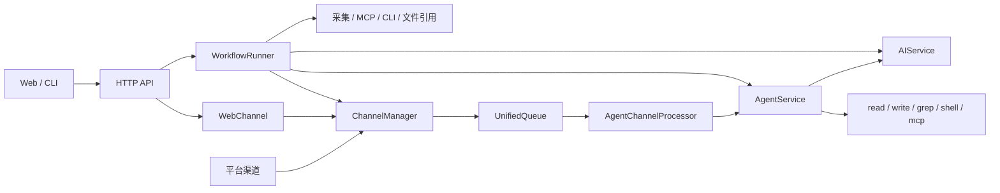

# 架构与数据边界

本文说明当前主分支的模块职责、数据流和存储位置。可观察行为以 [OpenSpec 主规范](../openspec/specs)为准；归档前未闭环的实现或验收记录在本地忽略稿中。历史测试数量不作为当前版本已通过回归的声明。

## 模块与装配

WorkFLowWeave 是异步模块化单体。固定 Workflow 与对话 Agent 共用 AI、采集、MCP、资源和渠道能力，各自管理执行状态和业务数据。

| 模块 | 职责与入口 |
| --- | --- |
| `lifecycle` | [ApplicationLifecycle](../src/workflowweave/lifecycle/service.py) 装配进程服务，管理启动、关闭、重载和健康状态 |
| `interaction` | [app factory](../src/workflowweave/interaction/app.py)、REST、CLI、Web 命令和两种 SSE；lifespan 委派 lifecycle |
| `config` | [资源仓库](../src/workflowweave/config/store.py)、配置迁移、引用校验、运行快照和插件发现 |
| `collection` / `mcp` | [采集管理器](../src/workflowweave/collection/manager.py) 统一执行 MCP、CLI 和文件引用；[MCP runtime](../src/workflowweave/mcp/runtime.py) 管理服务目录与调用 |
| `ai` | 模型服务、流式输出、凭据引用与 usage |
| `workflow` | 阶段图、执行与调度、事件订阅、业务归档 |
| `agent` | 会话与命令、静态图、工具、上下文压缩、事件和工作区 |
| `channel` | 平台会话、绑定、入站队列、命令准入、通知和原路回复 |
| `storage_primitives` | 共享 SQLite、JSONL 与文件存储原语 |

模块使用依赖注入与直接服务调用。HTTP 是对外边界，内部服务不通过 HTTP 相互调用。FastAPI 原生 SSE 传输已纳入当前规范；组合根重构的历史方案和未闭环边界保存在归档设计与本地分析稿中。

## Workflow

父图按 `collect → analyze → aggregate → notify → finish` 执行，另有清理节点。错误和空结果策略可以提前结束；分析与汇总均可按任务选择普通模型或 Agent。

| 目录 | 职责 |
| --- | --- |
| [graph](../src/workflowweave/workflow/graph) | 阶段图、逐项子图、state 和 reducer |
| [execution](../src/workflowweave/workflow/execution) | 触发、调度、取消、恢复、阶段重跑与维护 |
| [stream](../src/workflowweave/workflow/stream) | 消费执行事件，派生已提交事实与可读进度 |
| [storage](../src/workflowweave/workflow/storage) | 事务、事实去重、分类正文、版本查询和保留策略 |

运行开始时冻结资源和提示词。采集保留原始输出与执行事实；字段处理、格式转换和 token 限额由 Workflow 输入处理负责。独立任务可并行完成，结果按声明顺序组装。

Workflow 共享 `system_prompt` 和 `input_prompt`，任务可独立覆盖并提供差异 `user_prompt`。`null` 表示继承，显式空字符串保留其覆盖语义。Agent 任务的模型、工具范围与来源由当次快照确定；从结果继续对话不回写原 Workflow 结果。

持久化计划只有 `schedule` 一份，支持 `at/every/cron`；APScheduler 的内存作业在启动时从资源重建。MCP 健康检查有独立用途和计划。

### 恢复、归档与保留

| 数据 | 权威来源 | 用途 |
| --- | --- | --- |
| 执行位置和待完成任务 | LangGraph checkpoint 与 pending writes | 中断恢复 |
| 运行结果和历史正文 | SessionStore 的版本化业务事实 | 历史查询、报告和结果交接 |
| 运行页面 | 已提交事实投影出的完整 snapshot | 对外观察 |

默认数据库是 `data/workflows.sqlite3`。原轮次恢复沿用 `execution_epoch`，主动阶段重跑建立新轮次。恢复不读取最新资源替换冻结配置，也不从业务报告猜测执行位置。

业务归档按稳定 `write_key` 与 digest 追加：相同 key、相同内容复用版本；内容冲突明确失败。先提交正文和可用性，再发布 snapshot。归档失败保留恢复材料，不以清理或静默重试掩盖失败。

checkpoint 默认保留 7 天，采集正文 30 天，分析与最终报告默认不自动过期。四类期限和正文开关独立；关闭长期备份仍需保留执行所需 checkpoint。正文过期后保留版本、摘要和可用性事实，不能拿新轮次正文代替旧版本。完整在线过期与清理验收见 Workflow 活动任务。

## Agent 与渠道

[AgentService](../src/workflowweave/agent/service.py) 管理会话、轮次、取消、分支和运行资源；[GraphBuilder](../src/workflowweave/agent/runtime/builder.py) 由组合根编译静态图，轮次通过 runtime context 注入模型、提示词与工具范围。

工具入口为 `read/write/grep/shell/mcp`。`mcp` 按需发现工具、读取 schema 并调用；大型输出先完整保存为 artifact，再返回有限预览。文件工作区支持 `AGENTS.md`、Memory、History 和用户文件，不需要独立向量库。

| 数据 | 默认位置 | 职责 |
| --- | --- | --- |
| 用户指令和长期内容 | `data/agents/workspace/` | 用户与 Agent 维护的文件 |
| 会话事实与原始产物 | `data/agents/runtime/` | JSONL 事件、会话元数据和 artifacts |
| Agent 图状态 | `data/agents/runtime/checkpoints.sqlite` | 图执行持久化 |
| 渠道绑定与请求回执 | `data/agents/channels.sqlite3` | 平台会话、Agent 绑定和发送状态 |

JSONL 是用户可见执行事实的来源，支持单调事件 ID、游标重放和重启后的中断标记。无法确认结果的副作用调用记录为 `outcome_unknown`，不自动重新执行。

Web 和平台对话统一经过 `ChannelManager → UnifiedQueue → AgentChannelProcessor → AgentService`。Manager 管理入站、绑定、发送和回执；AgentService 管理模型轮次。Workflow 通知直接调用发送能力，不创建 Agent 会话。

平台对话身份与 Agent session 分离。单聊原路回复使用入站事件中的地址；主动通知使用配置的目标。绑定切换、排队中命令和不确定送达须遵守各自契约。平台接受请求不等于用户已读，也不构成恰好一次投递保证。

### 插件目录

- 包内插件位于 [src/workflowweave/plugins](../src/workflowweave/plugins/README.md)，随项目版本发布。
- 根目录 [plugins](../plugins) 是用户扩展入口，仓库只保存 `.gitkeep`。用户插件与 `plugins/config.json` 留在本地。
- 内置和用户插件由同一注册器发现，共用唯一启停配置；用户同 ID 插件不能覆盖内置插件。
- Docker 的用户插件使用独立持久卷，实际路径见 [部署说明](docker.md)。

平台参数、SDK 和聊天命令只在 [渠道说明](../src/workflowweave/plugins/channel/README.md)维护。真实账号收发缺口保留在渠道活动任务和证据目录，连接成功不能代替收发验收。

## 两种 SSE 与前端

| 项目 | Workflow | Agent / Web |
| --- | --- | --- |
| 入口 | `/api/sessions/{id}/events` | `/api/channels/web/sessions/{id}/events` |
| 来源 | 已提交业务事实 | Agent JSONL |
| 帧内容 | 完整 SessionRecord snapshot | 增量事件 envelope |
| 顺序 | 业务 `version` | 事件 ID 与 `turn_id` |
| 重连 | 查询最新完整 snapshot | `after` / `Last-Event-ID` 游标重放 |
| 客户端更新 | 仅接收更高版本 | 按事件游标去重与投影 |

断线只释放观察者，不取消运行或已受理轮次。取消通过显式业务操作执行；SSE 连接失败与有效 REST 查询的生命周期分开。

前端 [app](../frontend/src/app) 装配路由和依赖，[pages](../frontend/src/pages) 组合跨模块流程，[modules](../frontend/src/modules) 分别拥有 resources、workflows、runs、agents、system 的状态与 API，[shared](../frontend/src/shared) 提供 HTTP、EventSource、Schema 和基础 UI。跨模块消费公开契约，不复制模型、默认值或 Workflow 草稿。

## 文档与数据维护

本地运行只使用配置指定的 `data/`；运行库、密钥和个人资源不进入仓库。`deploy/docker/` 中的 bootstrap 与 Nginx 配置被 Dockerfile 直接引用，需要版本控制。

已验收行为维护在主规范；归档前的设计和欠账边界维护在本地忽略稿；使用步骤维护在指南或示例。规范与实现不一致时记录差距，不通过修改已确认需求来迁就实现。已完成的执行流水由 Git 历史查阅。
